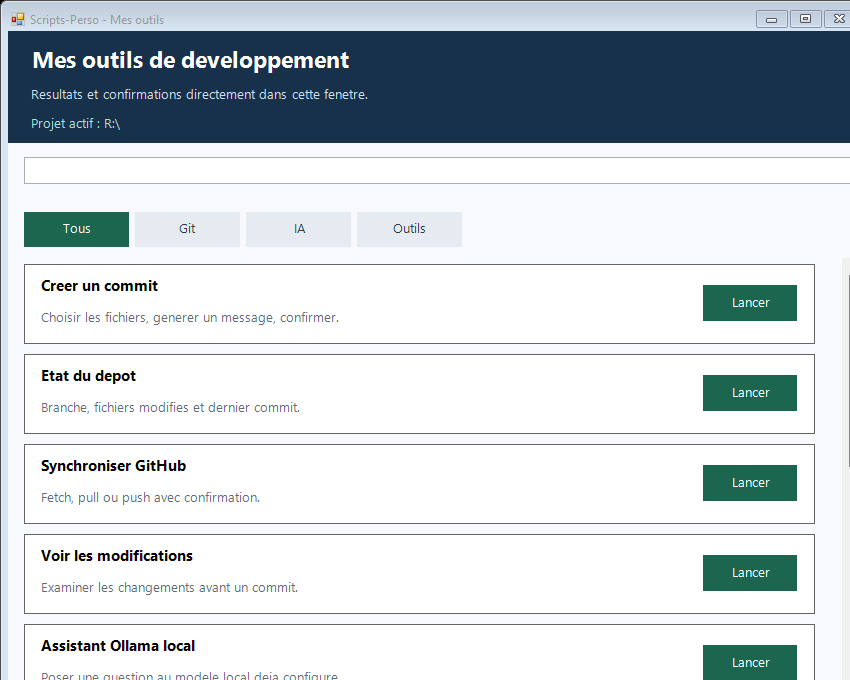
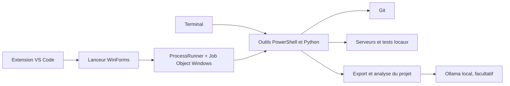

# Scripts-Perso

[](https://github.com/Fernandlabarre/windows-dev-toolbox/actions/workflows/ci.yml)
[](https://github.com/Fernandlabarre/windows-dev-toolbox/releases/latest)

Boîte à outils Windows pour les tâches répétitives autour d'un projet : état Git,
préparation d'un commit, serveurs locaux, contrôles automatisés, contexte VS Code
et analyse de fichiers.

Le lanceur graphique affiche les résultats et les questions des scripts dans
une seule fenêtre. Le **projet actif est le dossier depuis lequel tu le lances**.
La bibliothèque peut être installée où tu veux : son emplacement est déterminé
à partir du fichier du lanceur.

Le projet reste volontairement local : il n'installe pas de dépendance dans les
projets analysés et demande une confirmation avant les actions Git ou le lancement
de code. Les fichiers sensibles connus sont exclus ou masqués avant d'être affichés.



*Le lanceur sur Windows, avec un projet de démonstration.*

## En bref

| Ensemble | Ce qu'il fait |
| --- | --- |
| Lanceur Windows | Découvre les outils et centralise leurs résultats dans une interface WinForms. |
| Git | Inspecte un dépôt, prépare un commit et synchronise une branche sans force push. |
| Développement local | Lance un serveur npm ou sert un dossier public sur `127.0.0.1`. |
| Qualité | Détecte et exécute les contrôles Python, PowerShell et npm sans mode interactif. |
| Contexte projet | Produit un inventaire ou un export filtré sans envoyer de fichier sur le réseau. |
| VS Code et Ollama | Transmet un contexte IDE filtré à un assistant local, sans historique de conversation. |

## Démarrage rapide

```powershell
git clone https://github.com/Fernandlabarre/windows-dev-toolbox.git
Set-Location -LiteralPath '.\windows-dev-toolbox'
.\PowerShell\menu-scripts.ps1 -Project 'C:\chemin\vers\mon-projet'
```

Les scripts restent indépendants du lanceur. Par exemple :

```powershell
Set-Location -LiteralPath 'C:\chemin\vers\mon-projet'
& 'C:\chemin\vers\windows-dev-toolbox\Git\01-etat-depot.ps1'
```

## Architecture



Le détail des responsabilités, des flux et des limites de sécurité est décrit
dans [l'architecture technique](docs/ARCHITECTURE.md).

## Prérequis

- Windows et Windows PowerShell 5.1 ou PowerShell 7.
- Git accessible dans le terminal pour les outils Git.
- Python 3.9 ou plus récent pour l'exportateur et l'analyse d'espace, avec la bibliothèque standard.
- Facultatif : Ollama disponible sur `http://127.0.0.1:11434`, avec le modèle
  `qwen2.5-coder:7b`, pour proposer des messages de commit. La saisie manuelle
  reste disponible.

Conserver le dossier `PowerShell/Support` avec le lanceur : il contient le
processus d'exécution et la gestion de ses sous-processus.

## Utilisation

Depuis un terminal PowerShell, adapte ces deux chemins :

```powershell
Set-Location -LiteralPath 'C:\chemin\vers\mon-projet'
& 'C:\chemin\vers\windows-dev-toolbox\PowerShell\menu-scripts.ps1'
```

Vérifie le chemin « Projet actif » en haut de la fenêtre, choisis un outil,
puis utilise les boutons Oui/Non ou le champ de réponse lorsqu'une question
apparaît. Le lanceur emploie la même famille de PowerShell que celle dans
laquelle tu l'as ouvert.

### Contexte Visual Studio Code

L'extension locale `VSCode/scripts-perso-context` ajoute la commande
**Perso : ouvrir mes scripts avec le contexte IDE**. Le raccourci `Ctrl+1`
peut appeler cette commande : elle transmet au lanceur le dossier du projet,
le chemin du fichier actif et le contenu exact de l'éditeur, y compris les
modifications non enregistrées. Le contexte temporaire est supprimé à la fin
de la tâche VS Code.

Le contenu complet est limité à 60 000 caractères. Pour un fichier plus gros,
sélectionne la partie utile avant `Ctrl+1`. Les fichiers sensibles (`.env`,
clés, certificats, coffres de mots de passe et fichiers Git internes) ne sont
jamais transmis. Les jetons, clés et affectations sensibles reconnaissables
dans un fichier autorisé sont masqués avant même la création du contexte
temporaire.

Les scripts restent utilisables directement dans le terminal :

```powershell
# Voir l'état Git du projet courant.
& 'C:\chemin\vers\windows-dev-toolbox\Git\01-etat-depot.ps1'

# Exporter le projet courant, ou fournir un dossier explicitement.
python 'C:\chemin\vers\windows-dev-toolbox\Python\01-exporter-contexte-projet.py' .
```

## Outils disponibles

| Fichier | Rôle |
| --- | --- |
| `Git/01-etat-depot.ps1` | Branche, changements, dernier commit et dépôts distants. |
| `Git/02-voir-modifications.ps1` | Résumé des différences et contrôle de format. |
| `Git/03-creer-commit.ps1` | Sélection des fichiers, proposition Ollama facultative et confirmation du commit. |
| `Git/04-synchroniser-github.ps1` | Comparaison distante, pull fast-forward ou push avec confirmation. |
| `Git/05-preparer-contexte-ia.ps1` | Découpage des gros diffs, utilisé par l'assistant de commit. |
| `Python/01-exporter-contexte-projet.py` | Création du contexte Markdown et du ZIP de sources. |
| `Python/03-analyser-espace-projet.py` | Tailles des dossiers, gros fichiers, caches et archives, en lecture seule. |
| `PowerShell/01-diagnostic-developpeur.ps1` | Versions des outils de développement et état des ports TCP courants. |
| `PowerShell/02-gerer-serveurs-locaux.ps1` | Gestion d'un serveur npm ou Python dans une console indépendante. |
| `PowerShell/03-centre-tests.ps1` | Sélection des contrôles du projet et bilan de leur exécution. |
| `PowerShell/04-assistant-ollama-local.ps1` | Question au modèle Ollama existant et réponse dans le lanceur. |

Les scripts `.ps1` et `.py` ajoutés à la bibliothèque sont découverts
automatiquement. Les modules de support, le dossier `Tests`, le serveur Python
interne et l'outil Git de découpage restent masqués dans le menu.

## Précautions et comportement

Le **Diagnostic développeur**, dans la catégorie **Outils** du lanceur, vérifie
le PowerShell actif, Node.js, npm, Python et Ollama. Il observe les ports TCP
3000, 4173, 5000, 5173, 8000, 8080 et 11434. Un port occupé indique une écoute
TCP, sans garantir que le service est en bonne santé ni identifier son projet.
Un outil absent du PATH ou une version non vérifiable est signalé explicitement.
Les alias Windows susceptibles d'ouvrir un installateur sont ignorés.

Les commandes de version ont un délai limité. La vérification d'Ollama est
restreinte à la machine locale et ne charge aucun modèle. Aucun fichier de
configuration sensible, inventaire de modèles ou journal de projet n'est collecté.
Le diagnostic n'installe rien, ne démarre aucun serveur et n'arrête aucun
serveur existant. Seuls ses propres processus de vérification peuvent être
interrompus s'ils dépassent leur délai. Les sorties brutes des outils ne sont
pas affichées.

Utilisation directe, avec des ports personnalisés et un rapport PowerShell
structuré en complément de l'affichage :

```powershell
& 'C:\chemin\vers\windows-dev-toolbox\PowerShell\01-diagnostic-developpeur.ps1' -Ports 3000,5173,11434 -PassThru
```

Le **Gestionnaire de serveurs locaux** s'ouvre depuis **Outils → Serveurs locaux**
dans une console PowerShell dédiée. Le projet actif est conservé et le lanceur
reste disponible pour les autres outils. Un seul gestionnaire est autorisé
par projet, avec un serveur géré à la fois.

Dans la console : **1** démarre une commande après confirmation, **2** affiche
les journaux filtrés (Q pour revenir au menu), **3** actualise l'état, **4**
propose l'arrêt du serveur géré et **Q** ferme le gestionnaire. Fermer cette
console arrête aussi les processus qu'elle a lancés. Aucun processus existant
n'est choisi ou arrêté d'après son port.

Les scripts npm déclarés `dev`, `start`, `serve`, `preview` et leurs variantes
comme `dev:api` sont proposés. Ils exécutent le code du projet : choisir un
projet de confiance. Les hooks automatiques `pre`/`post` sont désactivés, comme
le permet [npm run-script](https://docs.npmjs.com/cli/v11/commands/npm-run-script).
Le gestionnaire n'installe aucune dépendance ; les bibliothèques nécessaires
au projet doivent déjà être disponibles. La configuration réseau des serveurs
npm reste celle définie dans le projet.

Le mode Python sert uniquement les dossiers `public`, `dist` ou `build`,
sur `127.0.0.1`, avec le port 8000 par défaut. La racine du projet, les chemins
sensibles, les sorties du dossier public et le listing des répertoires sont
refusés. Ce serveur est destiné au développement local. Un port déjà pris
produit un échec de démarrage ; aucun service n'est arrêté pour le libérer.

L'état « Processus actif » décrit le processus, et l'adresse affichée est celle
annoncée dans ses journaux : cela ne garantit pas la santé de l'application.
Les 200 dernières lignes filtrées restent en mémoire. Le masquage de secrets
reste partiel ; éviter de journaliser des données confidentielles dans les
applications. Aucun journal de serveur n'est écrit par le gestionnaire.

Le **Centre de tests**, accessible dans **Outils**, détecte les scripts npm
`lint`, `check`, `typecheck`, `type-check`, `test`, `build` et leurs variantes,
les tests Python `test_*.py` et les scripts PowerShell `test-*.ps1` des dossiers
`Tests`, `tests` ou `test` à la racine du projet. Les variantes de surveillance,
les interfaces de tests et les corrections automatiques explicites sont
écartées. Aucun outil de test supplémentaire n'est installé.

Choisis les numéros séparés par des virgules, **T** pour tous les contrôles
proposés ou **Q** pour annuler, puis confirme leur exécution. Chaque commande
s'exécute dans le projet actif, avec un délai maximal de 300 secondes, un mode
non interactif et `CI=true`. Les hooks npm `pre`/`post` restent désactivés.
Les commandes exécutent le code du projet et peuvent produire des fichiers
de tests ou de compilation : utiliser un projet de confiance.

Le bilan indique **Réussi**, **Échec**, **Partiel** ou **Non exécuté**, avec le
code retour et la durée. Zéro test Python détecté ne constitue pas une réussite.
Les tests ignorés ou contrôles explicitement non vérifiés produisent un bilan
partiel. Les sorties sont filtrées avec les mêmes limites que celles du
gestionnaire de serveurs ; aucun rapport n'est enregistré automatiquement.
La réussite porte sur les commandes sélectionnées, sans valider les contrôles
non exécutés ni garantir qu'un projet est prêt pour une livraison.

Utilisation directe avec un délai différent :

```powershell
& 'C:\chemin\vers\windows-dev-toolbox\PowerShell\03-centre-tests.ps1' -TimeoutSeconds 600
```

Le code de sortie est 0 pour une sélection entièrement réussie, 1 si un
contrôle échoue, et 2 pour un bilan partiel ou sans contrôle exécuté.
L'option `-PassThru` retourne aussi le rapport sous forme d'objet PowerShell.
Les suites pytest et les projets organisés autrement nécessitent pour
l'instant une commande déclarée dans le projet ou un script PowerShell de test.

L'**Assistant Ollama local**, dans **IA → Assistant Ollama local**, envoie une
question au modèle `qwen2.5-coder:7b` par défaut. La variable
`SCRIPTS_PERSO_OLLAMA_MODEL` ou le paramètre `-Model` permet de choisir un autre
modèle Ollama sans modifier le script. Depuis VS Code, utilise directement le
réglage `scriptsPerso.ollamaModel` ; il est transmis au menu lancé par `Ctrl+1`.
Saisis la question puis valide ; **Q** ou une saisie vide annule l'opération.
La réponse apparaît dans la même fenêtre. Chaque lancement est indépendant,
sans historique de conversation. Avec la commande VS Code, le fichier actif
est joint explicitement à la question. Pour analyser un autre fichier
enregistré, utilise un chemin relatif comme `@server/account-store.ts`.
Le script n'enregistre aucune question ou réponse et n'exécute pas le texte
produit par le modèle. Les réglages et journaux du serveur Ollama restent
gérés par Ollama.

Si l'API locale ne répond pas sur le port standard, l'outil lance
automatiquement l'exécutable Ollama déjà installé avec `ollama serve`, en
forçant l'écoute sur `127.0.0.1:11434`. Il ne télécharge aucun modèle et ne
démarre rien automatiquement pour un port personnalisé. Le modèle demandé doit
donc déjà être disponible. Le bouton d'arrêt du lanceur interrompt l'outil ; il
ne ferme pas le serveur Ollama, qui reste prêt pour les questions suivantes.
Les requêtes utilisent uniquement l'adresse locale, sans proxy ni redirection
HTTP.

L'[API chat Ollama](https://docs.ollama.com/api/chat) est utilisée sans
streaming : la réponse s'affiche à la fin de la génération. Le délai maximal
est de 180 secondes, la question est limitée à 8000 caractères et la génération
à 1024 jetons. La fenêtre de contexte demandée est de 16 384 jetons par défaut
et peut être ajustée avec `-ContextWindow`. Une réponse incomplète ou trop
longue est signalée **Partiel**.
Le filtrage des sorties garde les mêmes limites que celui des serveurs locaux.
Les lignes de réponse sont précédées de `|` pour rester du texte dans le lanceur.

Utilisation directe, avec un port et un délai personnalisables :

```powershell
& 'C:\chemin\vers\windows-dev-toolbox\PowerShell\04-assistant-ollama-local.ps1' -Question 'Comment structurer mes tests ?' -Port 11434 -TimeoutSeconds 300
```

L'option `-PassThru` retourne un objet avec le résultat, le texte filtré et la
durée. Sans cette option, le code de sortie est 0 pour une réponse complète
ou une annulation, 1 pour un échec et 2 pour une réponse partielle.

L'outil **Espace du projet**, dans **Outils**, mesure les fichiers du projet
actif à partir de leurs métadonnées. Il affiche la répartition par catégorie,
les principaux dossiers du premier niveau, les gros fichiers et les archives.
Les fichiers placés directement à la racine ont leur propre ligne dans la
répartition du premier niveau. Le rapport reste dans le lanceur ou le terminal.
Le script n'ouvre pas le contenu des fichiers et ne modifie pas le projet.

Les noms connus comme `node_modules`, `.venv`, `__pycache__`, `.cache`,
`dist`, `build` ou `coverage` servent d'indices. Ils ne prouvent pas qu'un
dossier est inutilisé ou supprimable. La première catégorie reconnue dans
un chemin détermine son groupe : les totaux par catégorie ne se superposent
pas. La liste des archives est une autre vue des fichiers déjà comptés.

Les tailles sont **logiques**, sans déduplication des liens physiques : elles
ne mesurent ni l'espace réellement alloué sur le disque ni un volume libérable.
L'arborescence peut aussi évoluer pendant le parcours.

Les chemins internes ou connus comme sensibles sont écartés avant leur
mesure, notamment `.git`, `.env*`, les configurations privées des agents,
les clés, certificats et bases de données. Les noms des entrées écartées ne
sont pas inscrits au rapport ; seuls leurs nombres sont indiqués. Le contenu
des dossiers exclus n'est pas dénombré. Les liens symboliques, jonctions et
autres points de réanalyse détectés sont ignorés. Une racine liée est refusée.

Le parcours est limité par défaut à **200 000 entrées**, **30 secondes** et
**64 niveaux**. Le budget de temps est vérifié entre les accès au système de
fichiers. Une limite atteinte ou une erreur de métadonnées produit un rapport
**Partiel**. Un résultat complet porte uniquement sur le périmètre mesuré.
Les dix premiers résultats de chaque classement sont affichés par défaut.

Utilisation directe, avec des limites adaptées :

```powershell
python -B 'C:\chemin\vers\windows-dev-toolbox\Python\03-analyser-espace-projet.py' . --top 15 --timeout 60
```

Les options `--max-entries` et `--max-depth` règlent les autres limites.
`--json` écrit un rapport structuré sur la sortie standard, sans créer de
fichier. Les codes de sortie sont 0 pour un rapport complet dans son périmètre,
2 pour un rapport partiel et 1 pour une erreur de dossier ou de paramètres.

L'assistant de commit demande confirmation avant de préparer les fichiers et
avant de créer le commit. Il refuse de démarrer si des fichiers sont déjà
préparés. Lors de la sélection, saisis **T** pour choisir tous les fichiers
détectés, ou conserve la sélection par numéros pour n'en choisir qu'une partie.
Après une annulation ou une erreur survenue après la préparation,
les fichiers sélectionnés **restent dans l'index Git** : examine-les avant
de relancer l'assistant.

La synchronisation commence par un fetch, refuse une divergence des branches
et propose uniquement un pull fast-forward. Le push demande une confirmation.
Vérifie la branche affichée avant de confirmer un envoi, notamment sur `main`
ou `master`.

L'arrêt d'urgence arrête le processus de l'outil et ses descendants, regroupés
dans un [Job Object Windows](https://learn.microsoft.com/en-us/windows/win32/procthread/job-objects).
Le groupe est également fermé si le lanceur quitte inopinément. Une opération
déjà effectuée n'est pas annulée : après une interruption, vérifie le statut
Git et les éventuels fichiers de sortie avant de reprendre.

## Export de contexte projet

Les résultats sont créés dans un nouveau sous-dossier de
`%USERPROFILE%\Exports-IA` :

- `01-CONTEXTE.md` : technologies, arborescence et motifs d'exclusion.
- `02-CODE-SOURCE.zip` : octets d'origine des fichiers admissibles.

L'exportateur filtre les chemins sensibles, les liens sortant du projet, les
binaires, les fichiers de plus de 1 Mo et certaines signatures de secrets.
Il détecte notamment les affectations littérales `API_KEY`, `ACCESS_TOKEN`,
`CLIENT_SECRET` et `PASSWORD`, avec ou sans préfixe, dans les formats courants
Python, PowerShell, JavaScript, JSON et YAML.

Ce filtrage reste partiel : il conserve un seuil de 12 caractères pour les
valeurs des affectations et ne reconnaît pas toutes les données personnelles
ou confidentielles. **Vérifie les fichiers exportés avant de les partager.**
L'exportateur ne réalise aucun envoi réseau.

## Vérifications

Depuis la racine de la bibliothèque :

```powershell
python -B -m unittest discover -s .\Tests -p 'test_*.py' -v
powershell.exe -NoProfile -NonInteractive -File .\Tests\test-lanceur.ps1
pwsh.exe -NoProfile -NonInteractive -File .\Tests\test-lanceur.ps1
powershell.exe -NoProfile -NonInteractive -File .\Tests\test-diagnostic-developpeur.ps1
pwsh.exe -NoProfile -NonInteractive -File .\Tests\test-diagnostic-developpeur.ps1
powershell.exe -NoProfile -NonInteractive -File .\Tests\test-serveurs-locaux.ps1
pwsh.exe -NoProfile -NonInteractive -File .\Tests\test-serveurs-locaux.ps1
pwsh.exe -NoProfile -NonInteractive -File .\Tests\test-centre-pwsh.ps1
powershell.exe -NoProfile -NonInteractive -File .\Tests\test-assistant-ollama.ps1
pwsh.exe -NoProfile -NonInteractive -File .\Tests\test-assistant-ollama.ps1
powershell.exe -NoProfile -NonInteractive -File .\Tests\test-commit.ps1
pwsh.exe -NoProfile -NonInteractive -File .\Tests\test-commit.ps1
git diff --check
```

La suite Python vérifie le filtrage, les exclusions, l'inventaire Git et un
export ZIP complet, ainsi que l'analyse d'espace sur des dossiers factices.
Les tests d'espace couvrent les totaux, les classements, les exclusions,
les limites, les erreurs d'accès, les liens/jonctions, le mode JSON et le
respect de la lecture seule. Pour ne lancer que cette suite :

```powershell
python -B -m unittest discover -s .\Tests -p 'test_espace_projet.py' -v
```

La suite PowerShell vérifie la syntaxe, les réponses
interactives, les chemins avec espaces ou crochets, les accents, l'exécution
Python, les codes d'erreur et l'arrêt d'un parent avec deux générations de
sous-processus. Les tests utilisent leurs propres fichiers et processus
temporaires ; ils ne synchronisent aucun dépôt distant.

La suite de l'assistant de commit initialise uniquement des dépôts factices.
Elle vérifie que **T** prépare tous les fichiers en une saisie et que la
sélection partielle par numéros reste inchangée. Aucun commit ni push n'est
effectué.

L'option `-Gui` de la suite PowerShell vérifie aussi le parcours graphique
avec une bibliothèque déplacée et un outil factice : lancement, réponse Oui,
fin de l'outil et réouverture dans la même session. Elle nécessite une session
Windows avec bureau interactif.

La suite du diagnostic vérifie aussi les outils absents, les erreurs de
commande, les délais, le masquage des sorties brutes et une vraie écoute TCP
créée uniquement pour le test. Le parcours `-Gui` lance le diagnostic dans
une copie déplacée de la bibliothèque et vérifie son rapport dans la fenêtre.
Si l'écoute factice n'est visible ni dans les tables TCP .NET ni dans celles
de Windows, ce contrôle physique est signalé « NON VÉRIFIÉ ».

Les tests des serveurs utilisent des projets et fichiers factices. Ils
vérifient les réponses HTTP locales, les refus des chemins sensibles, le
masquage des journaux, l'arrêt ciblé, la survie entre deux outils et la fermeture
des descendants avec le gestionnaire. Aucun projet professionnel n'est lancé.

La suite du Centre s'exécute sous PowerShell 7. Elle couvre les commandes réussies ou en échec, les délais,
les outils manquants, les contrôles non sélectionnés, les tests Python absents
ou ignorés et les manifests modifiés après sélection. Le parcours graphique
vérifie la sélection, la confirmation et l'affichage du bilan dans le lanceur.

La suite Ollama utilise une API HTTP factice liée à la boucle locale, avec
Python et sa bibliothèque standard. Elle vérifie les réponses UTF-8, les
erreurs, les délais avant et après les en-têtes, le refus des redirections,
les sorties filtrées, les réponses partielles et l'annulation. Le parcours
graphique utilise aussi cette API factice ; il ne charge aucun modèle.
Le sixième parcours graphique vérifie le rapport d'espace du projet dans
une bibliothèque déplacée, avec le bon dossier actif et un fichier factice.

Pour un contrôle visuel, ouvre le lanceur depuis un projet, vérifie son chemin
actif et lance « État du dépôt ». Les scénarios avec Ollama et l'authentification
GitHub nécessitent les services correspondants.

## Documentation complémentaire

- [Architecture technique](docs/ARCHITECTURE.md)
- [Historique des versions](CHANGELOG.md)
- [Politique de sécurité](SECURITY.md)

Le code est visible pour consultation et présentation du projet. Sa réutilisation
n'est pas autorisée sans accord préalable ; les conditions figurent dans
[la licence](LICENSE).
