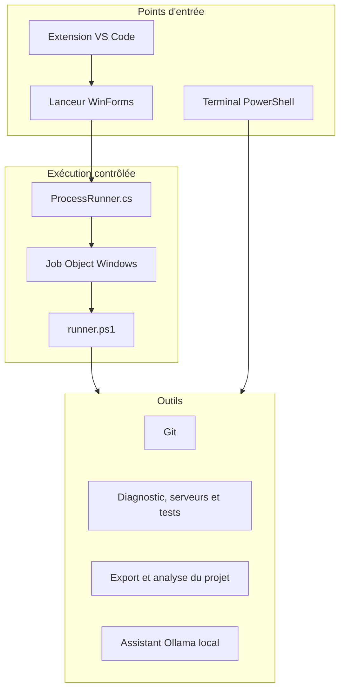

# Architecture technique

Scripts-Perso regroupe plusieurs outils indépendants derrière un même lanceur.
Chaque outil peut aussi être exécuté directement depuis un terminal. Cette
séparation permet de garder une interface pratique sans rendre les scripts
dépendants de l'interface graphique.

## Vue d'ensemble



## Responsabilités

| Zone | Fichiers principaux | Responsabilité |
| --- | --- | --- |
| Interface | `PowerShell/menu-scripts.ps1` | Découverte des outils, recherche, affichage et réponses interactives. |
| Processus | `PowerShell/Support/ScriptsPersoRunner.cs` | Lancement, capture des sorties et arrêt de l'arbre de processus. |
| Adaptateur | `PowerShell/Support/runner.ps1` | Encodage UTF-8 et protocole entre un script console et le lanceur. |
| Git | `Git/*.ps1` | Inspection, préparation d'un commit et synchronisation prudente. |
| Développement | `PowerShell/01-*.ps1` à `04-*.ps1` | Diagnostic, serveurs, contrôles et assistant local. |
| Projet | `Python/*.py` | Export filtré, serveur statique restreint et mesure de l'espace. |
| VS Code | `VSCode/scripts-perso-context` | Capture du fichier actif, filtrage puis ouverture du lanceur. |
| Validation | `Tests/` | Tests unitaires et scénarios d'intégration sur des projets factices. |

## Exécution d'un outil

1. Le lanceur découvre les scripts autorisés et construit son catalogue.
2. `ProcessRunner` crée un Job Object Windows puis démarre le processus derrière
   une barrière nommée.
3. Après le rattachement au Job Object, la barrière est ouverte et `runner.ps1`
   adapte les entrées et sorties du script console au protocole du lanceur.
4. Une file thread-safe reçoit les messages. Seul le minuteur WinForms modifie
   les contrôles graphiques.
5. À l'arrêt, le Job Object ferme aussi les processus descendants créés par
   l'outil.

Ce modèle évite qu'un serveur, un test ou une commande enfant reste actif après
la fermeture du lanceur. Une opération déjà effectuée, comme un commit, n'est
évidemment pas annulée par l'arrêt du processus.

## Contexte Visual Studio Code

L'extension écrit un fichier JSON temporaire avec le projet, le fichier actif
et, dans les limites prévues, son contenu non enregistré. Avant l'écriture :

- le fichier doit appartenir au projet ;
- les chemins sensibles sont refusés ;
- les formes courantes de jetons, clés et identifiants sont masquées ;
- la taille du document et de la sélection est plafonnée.

Le fichier temporaire est supprimé à la fin de la tâche. Les anciens fichiers
du même format sont aussi nettoyés après 24 heures.

## Limites de sécurité

Le projet adopte une règle simple : ne pas élargir silencieusement son périmètre.

- Le serveur Python écoute uniquement sur `127.0.0.1` et ne sert que `public`,
  `dist` ou `build`.
- Le gestionnaire n'arrête que les processus qu'il a lui-même lancés.
- Le centre de tests n'installe rien et écarte les modes interactifs, de veille
  ou de correction automatique.
- L'exporteur ignore les liens sortants, les fichiers sensibles connus, les
  binaires et les fichiers trop volumineux.
- L'assistant Ollama n'utilise que l'API locale et n'exécute jamais sa réponse.

Les filtres restent volontairement décrits comme partiels : un export ou un
journal doit toujours être relu avant d'être partagé.

## Tests

Les tests couvrent trois niveaux :

- Python : filtrage, inventaire, liens, serveur HTTP et analyse de l'espace ;
- PowerShell : processus descendants, interactions, Git factice, ports et
  erreurs ;
- Node.js : confinement des chemins et masquage du contexte VS Code.

La CI exécute ces contrôles sur Windows. Les scénarios graphiques restent
facultatifs, car ils demandent une session de bureau interactive.

## Capture de la documentation

Le lanceur peut enregistrer son propre rendu WinForms sans outil de capture
externe :

```powershell
.\PowerShell\menu-scripts.ps1 `
    -Project 'C:\chemin\vers\un-projet-de-demonstration' `
    -ScreenshotPath '.\docs\images\launcher.png'
```

Ce mode construit l'interface, écrit le PNG puis ferme la fenêtre sans lancer
aucun outil du catalogue.
